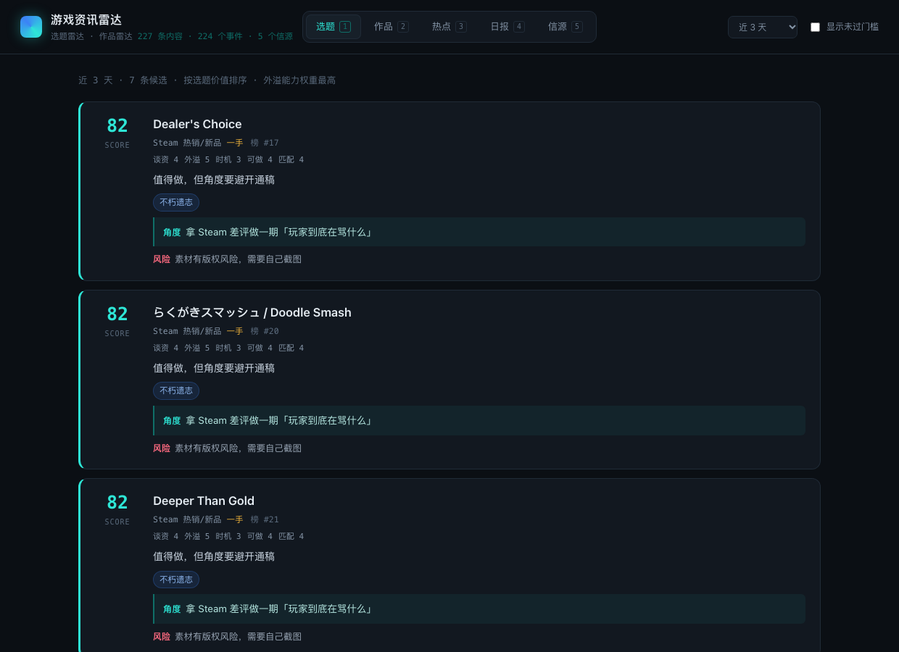

# 游戏资讯雷达

给游戏编辑用的热点雷达。每天扫一遍信源，回答两个问题：

1. **今天有什么值得做的选题？**（不限于游戏，包括游民星空、3DM、小黑盒会采的那类外围内容）
2. **有什么值得关注的游戏？**（服务引进发行业务）

灵感来自卡兹克的 [AIHOT](https://github.com/KKKKhazix/AIHOT)，方法论照抄，但把它从「全行业热点站」改成了「编辑的选品工具」。



> 上图是用本地 mock 模型跑通链路的验证截图，分数不是真实评分。填好 key 跑一遍 `npm run run` 就是你自己的数据。

---

## 和 AIHOT 的关系

AIHOT 的核心机制我全部保留了：

- **信源分级**：一手 / 准一手 / 二手，门槛不同（`tier` 3/2/1）
- **双打分降噪**：分数贴着门槛时再打一次，分歧大就取低值，防止单次抬分把噪音送进精选
- **事件聚簇**：同一件事多个来源报道 → 聚成一个事件，不重复占位
- **热度按事件算**：48 小时内每个独立来源只算一次，24 小时前对半折。一家媒体发十篇也只算一次

改了三处，因为这三点决定了它能不能真的用在你的工作上：

| | AIHOT | 这里 |
|---|---|---|
| 输出 | 一份日报 | **两条独立队列**，各有各的门槛和打分标准 |
| 打分 | 一套标准 | **两套五轴标准**：选题看谈资/外溢/时机/可做/匹配；作品看品质/品类/商业/势能/落地 |
| 技术栈 | Docker + Postgres + pgvector + pg-boss | Node 24 + `node:sqlite` + 原生 TS，**零依赖、零构建、一条命令** |

第三条不是偷懒。你这台机器没有 Docker 也没有 Postgres，而 AIHOT 那套的价值在**打分标准和聚簇算法**，不在排队框架。为了跑一个每天看两次的面板装一套并发基础设施，维护成本会先把你压垮。

代价也说清楚：没有向量检索，聚簇靠标题 n-gram 重合度 + 模型判同；数据量上万条之后召回会变差（见文末局限）。

---

## 快速开始

```bash
cd app

# 1. 填模型 key（DeepSeek / 千问 / 智谱都行，OpenAI 兼容即可）
cp .env.example .env
#    然后编辑 .env，把 LLM_API_KEY 换成你自己的

# 2. 自检（不联网、不花 token）
node scripts/selftest.mjs

# 3. 跑一遍完整流程：抓取 → 聚簇 → 打分 → 出日报
npm run run

# 4. 打开看板
npm start        # http://127.0.0.1:7317
```

第一次跑大约 2–5 分钟（取决于信源数量和打分条数）。之后再跑只会处理新内容。

---

## 每天怎么用

1. 打开看板，**选题**标签页是按选题价值排的。看分数、看「角度」那一行——那是模型给的切入方式，不是标题。
2. 顺手扫一眼**风险**：每条都强制给了反方理由。写不出反方的说明模型没看懂，别信这条。
3. 转**作品**标签页，看「下一步」：联系开发组 / 等 Demo / 放弃，都是具体动作。
4. **日报**页可以直接复制成飞书消息。
5. 看到分数明显不对的，去 `app/src/prompts/radar-topic.md` 或 `radar-game.md` 改标准——那才是这套东西真正的 KnowHow，代码不用动。

键盘 `1`–`5` 切标签页。

---

## 它是怎么工作的

```
信源（27 个）
  ↓  collector.ts   RSS / JSON / HTML 三种适配器，同域名限速 1.2s，ETag 增量
入库 items                     一次全量约 1000 条
  ↓  URL 判重 + 跨源标题指纹判重（同一件事不重复进队列）
规则预筛
  ↓  挡掉招聘、免责声明、导航标题
模型预筛（新）                   25 条一批，只判「值不值得细评」
  ↓  砍掉约 85%，选题 ≥45 / 作品 ≥55 才放行
两条雷达各自细评（五轴）          贴着门槛的再打一次，分歧取低值
  ↓
scores
  ↓  cluster.ts  标题 n-gram 找候选 → 模型判「同一件事/后续进展/两件事」
events
  ↓  computeHeat()  独立来源计数 + 24h 半衰 + 信源分级加权
热点榜 / 日报
```

**为什么要有模型预筛**：一次全量约 1000 条，每条两端都五轴细评约 1.5k token，一天就是 300 万 token。预筛用标题批量粗排（25 条一次），成本只有细评的 1/30，却能砍掉 85% 的废话——因为「值不值得看」这件事，标题基本就够了。真正需要细看的是「怎么切入」。

**为什么分两次判重**：URL 判重挡转载，标题指纹挡「换个说法重发」。两个都过不了的才进队列，省 token 也省你的注意力。

**为什么热度不按文章数算**：一家媒体发十篇，说明它自己很重视，不代表很多人在讨论。只有**独立来源数**才接近「有多少人在说」。

---

## 改 KnowHow

| 你想改什么 | 改哪个文件 |
|---|---|
| 选题的标准、门槛、什么算好选题 | `app/src/prompts/radar-topic.md` |
| 引进选品的标准、什么算好苗子 | `app/src/prompts/radar-game.md` |
| 入选分数线 | `app/src/config.ts` 的 `THRESHOLDS` |
| 五轴的权重 | `app/src/prompts/*.md` 的公式 **和** `app/src/score.ts` 的 `WEIGHTS`（两处要一致） |
| 加信源 / 修抓取 | `app/sources.json`，格式见 `app/docs/sources.md` |

打分标准写成了中文 markdown，直接改文字就行。改完重跑 `npm run score` 立刻生效。

**校准建议**：先跑一周，把你觉得该进没进、不该进却进了的条目记下来，回头对照五轴的 `why` 看是哪一轴打错了，再改那一段文字。不要一上来就调门槛数字。

---

## 命令

```bash
npm run run                    # 抓取 → 聚簇 → 预筛 → 细评 → 日报（日常用这个）
npm start                      # 看板
npm run collect -- --force     # 只抓取，忽略缓存
npm run prescreen -- --days=2  # 只做标题粗排
npm run score -- --radar=topic --limit=30 --days=3
npm run score -- --all         # 跳过预筛门槛，全部细评（贵，调试用）
npm run digest                 # 只出日报
npm run status                 # 数据概览 + 每个信源的健康度
node src/cli.ts hot            # 当前热点（命令行看）
node src/cli.ts probe --file=sources.d/cn-media.json   # 验证信源配置，不入库
```

定时跑（macOS，每天早上 8 点）：

```bash
crontab -e
0 8 * * * cd /Users/tmr/Documents/DeepSeek/资讯看板/app && /usr/local/bin/node src/cli.ts run >> data/cron.log 2>&1
```

---

## 跑在哪：本地 / GitHub Actions

两种都验证通过了。

**本地**（默认）：
```bash
cd app && npm run run && npm start     # 127.0.0.1:7317
```

**GitHub Actions**（本机不常开时用这个）：
仓库 `.github/workflows/daily.yml` 每天 08:00（北京时间）自动跑一遍完整流程，把数据库和导出的静态数据**提交回仓库**，`docs/` 就是可以直接托管的静态站。手动跑一次：`gh workflow run daily.yml`。

> ⚠️ **本地和云端共用同一个 `app/data/radar.db`**，所以 pull 之后必须先清掉 `-wal` / `-shm`，否则「新库 + 旧 WAL」会让 SQLite 报 `database disk image is malformed`（我踩过一次）。用 `npm run sync` 代替裸 `git pull`。

## 信源现状

27 个信源，覆盖：

- **国内垂媒（7）**：机核（JSON:API，带点赞/评论数）、游民星空（单页 178 条）、3DM（秒级时效）、游研社、触乐、indienova、GameLook
- **社区热榜（7）**：B站全站排行、微博热搜、知乎热榜、百度热搜、抖音热点、贴吧热议、Reddit r/games
- **海外媒体（6）**：IGN、Eurogamer、PC Gamer、RPS、GamesIndustry、Gematsu
- **平台（4）**：Steam 热销/新品/即将发售三榜合一（自动补品类、简介、评测数）、PS Blog、Xbox Wire、任天堂
- **TapTap 站内（3）**：预约榜、下载榜、在玩榜

**探测过但拿不到的，别浪费时间重试**：

| 源 | 原因 |
|---|---|
| 小黑盒 | 接口需要签名，无公开稳定入口 |
| SteamDB 愿望单榜 | Cloudflare 反爬挑战 |
| VGtime | **域名已废**，首页是 SEO 镜像壳 |
| TGA / Summer Game Fest / Day of the Devs | 官网是 JS 渲染，HTML 里没有内容 |
| 小红书 | 点赞数是「3.1万」这类字符串，链接是 SPA 空壳，点不开 |
| YouTube 频道 RSS | 免 key 可用但有 IP 级限速，连续几次后稳定 404 |
| 游民星空站内 RSS | 403/404，只能扒页面 |

**引进业务最痛的一处**：愿望单量级公开拿不到。Steam 官方接口不返回，SteamDB 被 Cloudflare 挡，VG Insights / Gamalytic 收费。现实替代是 `recommendations.total`（评测总数）+ 榜位 + 媒体提及家数——雷达里就是这么算的，别指望能拿到精确愿望单数。

细节和每个源的坑见 `app/docs/sources.md`。

---

## 已知局限（这些是真的，不是免责）

1. **没有向量聚簇**。目前是「token 集合 Jaccard」：中文切字 bigram、英文切词，阈值 0.24，灰区（0.14–0.24）交给模型判同。对完全换说法的转载（"BioWare 关门" vs "EA 关闭生软"）会漏。数据量上万后召回下降更快。要根治得接 embedding 服务——DeepSeek 没有，千问/智谱有。
2. **HTML 源的时效不可靠**。游民星空单页 177 条但**不是时间倒序**，必须按 `publishedAt` 重排；触乐只能拿到日期，拿不到时分。
3. **热榜条目没有正文**。微博热搜、B 站排行只有话题名，模型只能凭标题判断，`craft` 轴会偏低——这是正确的，因为确实还没素材。
4. **打分有随机性**。同一批内容重跑，分数会有 ±5 的浮动。所以贴着门槛的才复检，而不是追求全局确定性。
5. **成本**。日常量级：预筛 1000 条约 40 次调用，细评约 150 条 × 2 端。按 DeepSeek 现价大约是每天 1–2 元人民币。换推理模型会贵 5–10 倍，`LLM_MAX_CALLS_PER_RUN` 是保险丝。
6. **软性采集边界**。这些都是公开页面，但没有任何一家给过授权。抓取限速 1.2s/域名、只取公开入口、不绕验证码。**如果要把它变成团队共用服务或对外产品，先去核对各站的 robots 和条款。**

---

## 目录

```
app/
  src/
    cli.ts          命令行入口
    config.ts       配置与门槛
    types.ts        类型
    db.ts           SQLite + 判重指纹
    fetch.ts        礼貌抓取（限速/重试/ETag）
    parsers.ts      RSS / HTML / JSON 解析，零依赖
    adapters.ts     行块抽取 + 字段映射
    sources.ts      信源注册与同步
    collector.ts    抓取入库
    score.ts        两条雷达的打分
    cluster.ts      事件聚簇 + 热度
    pipeline.ts     打分队列 + 精选榜
    discover.ts     Steam 发现层（新品/即将发售/带 Demo，只留支持中文的）
    heat.ts         B站播放量证据（24 小时缓存）
    bili.ts         B站 wbi 签名搜索，零依赖
    translate.ts    英文标题译成中文（只做展示，不参与判重）
    steam.ts        作品外部事实：发售日/已上线天数/评价数/国区价
    digest.ts       日报
    server.ts       HTTP + API
    prompts/        ★ 打分标准（KnowHow 在这）
  public/           看板前端（无框架）
  sources.json      信源配置
  sources.d/        信源配置分片（合并用）
  docs/sources.md   信源格式说明
  scripts/          自检、信源合并
research/           信源探测原始报告与可重跑脚本
```

---

## 发现层：媒体不会写的那批作品

编辑部的重点游戏有两类来源。一类是媒体会报道的（新作首曝、厂商官宣），另一类媒体几乎从不写：**独立小体量、有中文、有 Demo、首周几十条评价**。后一类才是引进谈判的主体，而它们的证据结构是「Steam 评价数 + 在线 + B站播放」，不在任何 RSS 里。

所以除了 27 个媒体/社区信源，还有两条独立通道：

```bash
npm run discover            # Steam 新品 / 即将发售 / 带 Demo，只收支持中文的
npm run backfill -- --appids=5186030,3432980   # 已知 appid 补录（迁移历史用）
```

- **发现层**（`src/discover.ts`）扫 Steam 三个列表，逐个查 `appdetails` 拿发售日/评价数/国区价/支持语言，只保留中文作品，写入伪信源 `steam_discover`。未发售的作品不写 `publishedAt`（否则未来日期会排到「最新」第一）。
- **B站证据**（`src/bili.ts` + `src/heat.ts`）在打分前作为「外部事实」拼进提示词：`B站站内搜索：头部 5 条视频合计 X 播放`。它和 Steam 的评价数是两个维度——Steam 说明国外有人在玩，B站说明国内有人在看。两者都高是成熟标的；Steam 冷、B站热是「国内创作者比商店页先发现它」的首曝窗口。
- **补录**（`backfill`）把已知 appid 直接拉进库，`publishedAt` 写「现在」而不是真实发售日——对我们来说它是「今天才发现的作品」，写真实日期会落在时间窗之外，永远进不了队列。

实测：把编辑部 Slack 里记过的 22 款作品全部补录后，雷达给出的分数（机械迷城2 80、巨蟹横行 75、VHOLUME 74、人偶之影 73、Chalk Warfare 61）与人工判断高度一致——说明判断标准本身是对的，之前缺的是**入口**，不是标准。
